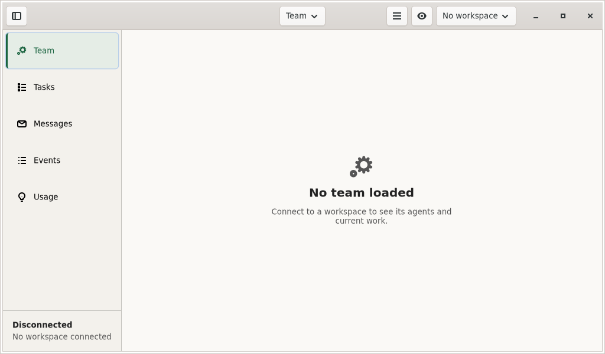
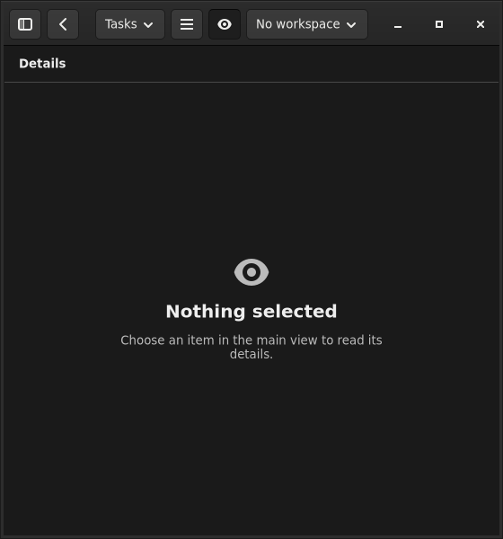

# Early native shell design review

Task: `native-shell-design-review`. Review date: 2026-10-05.

This review covers the native navigation foundation before domain, transport and
terminal integration. The reference is `notes/native-apps.md` at `5015460a`.
It supplements the later `native-visual-signoff`; an unconnected shell is not a
connected application. No operator session, credential or listener is changed.

Status: bounded early review complete. The captured Linux hierarchy and palette
match the foundation contract; one keyboard defect is fixed and two accessibility
observations need follow-up. Apple source/icon inspection found no material design
disagreement. This is not final native visual or accessibility sign-off, and no
complete native acceptance row is passed by this checkpoint.

## Apple: source and asset inspection

Exact candidate: `4479a30185f47672347c2d1e47e8660685b87734`, supplied by `ui`.
Files were read from that commit, without merging its branch. The following
observations are source/asset evidence only:

| Area | Observation | Limit |
| --- | --- | --- |
| Identity | `CrewApp/Resources/AppIcon.svg` exactly reuses the existing `web/index.html` diamond path `M8 1 15 8 8 15 1 8Z`, fill `#6ebef0`, on `#121212`. The 16, 32 and 1024 pixel exports were viewed; the silhouette is clear and has no fine details, text or new mark. | No claim about appearance after an Apple launcher applies its own presentation. |
| Raster resources | PNG headers confirm all seven exports at 16, 32, 64, 128, 256, 512 and 1024 pixels; all are opaque RGB. The catalog refers to matching files. | Asset inspection is not an Xcode asset-catalog build. |
| Colour | Named assets retain neutral dark canvas/surface/raised values `#121212`, `#1a1a1a`, `#242424`; warm light canvas `#f5f6f3`, white surface and `#eef1ed` raised surface. General actions use blue in dark and green in light. Increased-contrast accent variants exist. | Source values do not establish rendered text/control contrast with the OS theme. |
| Navigation | `CrewDestination` defines exactly Team, Tasks, Messages, Events and Usage. `CrewShell` uses labelled compact-iOS tabs, per-destination navigation paths and regular-width/native desktop split navigation. One `CrewNavigation` belongs to each root window. | Selection/path identity is inspectable in source; resize behavior and native focus still require execution. |
| Constrained width | Accessibility Dynamic Type sizes choose the compact iOS composition. macOS hides the sidebar below its shell threshold; its destination menu remains available, and `SidebarCommands` supplies a native restore route. | The exact narrow/large-text result is unverified on Apple. |
| Local controls | Appearance, Connections and Help remain outside the work destinations. Buttons have text or explicit accessibility names; iOS primary/menu/workspace/Done controls request 44pt activation areas. Native text styles and scroll containers are used. | Requested sizes/names are not measurements from an accessibility tree or device. |
| Empty state | Each destination says to connect/select a workspace; the status explicitly says not connected and no workspace selected. Connections says setup is currently unavailable. No fictitious agents, successful connection, counts or live actions appear. | Honest foundation behavior; S01–S08 enrollment and connected views are still later work. |
| Authority copy | Connections distinguishes iOS gateway access from a protected same-host Mac connection, keeps the browser no-paste rule, and explains that Control/Terminal use existing host permissions rather than a new OS sandbox. | No actual authentication, permission or credential-storage behavior exists in this shell. |
| Evidence claims | `CrewApp/README.md` separates Linux parsing/project checks from Apple builds and manual UI checks. Its deferred commands stage a private source copy and disable signing for the documented build runs. | Author-reported source checks were not rerun by this design review. No Apple test result is inferred from them. |

No material design disagreement was found in this bounded Apple source/asset
inspection. The separate asset/source answer was sent as `m-cebda85bd933` to `ui`
and `m-d21ce3504009` to `reviewer`.

**Apple verification deferred by operator.** Native screen rendering, Dynamic
Type/size behavior, contrast, menu/sidebar restoration, keyboard focus after a
sheet or Connections window closes, VoiceOver, reduced motion and actual
asset-catalog acceptance remain unverified. The two source UI tests cover
destination copy and opening/closing Connections; the post-close assertion
checks that its opener exists, not that accessibility/keyboard focus returned.
The README already names the manual focus and accessibility checks. Owners:
`ui` for source, `qa` for later runner evidence. This is an execution limit,
not an observed focus defect.

## Linux: actual shell review

The initial published crate is `c45703fff782c6a4d2573437771be08a99ba3139`;
the reviewed follow-up is `d4d31a134b89e62f38e5cf32040708d695affb0e`.
Workspace registration is separately `32ab8f0e8046478700726de64c65e1f91fc509ba`.
Both source versions were staged into an ignored directory in the designer's
workspace and built with the registered lockfile, `cargo +1.93 build --locked
-p crew-desktop --features native-ui -j 2`. The `+1.93` toolchain reported
`rustc 1.93.1`; initial build completed in 27.57 seconds and the follow-up in
0.83 seconds. No product or root workspace file was edited.

The independent binaries have SHA-256 values
`0ab9aab3b2f7a331521684340781a4d43bc15b0016a50f80668e2d7ec0044434`
(initial) and
`ac0dc72ec0ba69412141ebb7e10f281639e944c3422b324f8e2489432a8fddd1`
(follow-up). Runtime library setup used the exact approved QA helper
`0198317b281e2bde0caf451eb5cdfb48094b3505`. A private Xvfb display,
Openbox window manager, D-Bus session and accessibility bus were used; no
operator display, daemon, listener or configuration was changed. The actual
application remained disconnected throughout.

The retained overview images are from graph's immutable follow-up binary,
SHA-256 `755b12c20ed0a8b8e47af42fdbf5cf4f52863389771a85ee904c2f0a0809637b`,
and capture set `linux-window-test-2A2pv4`. These images were viewed directly,
then copied byte-for-byte. Independent keyboard/AT-SPI observations below come
from the designer's separately built binaries. The earlier QA `9e98…`
loader-baseline image is not used for this design verdict.

| Check | Observed result and scope |
| --- | --- |
| Hierarchy and typography | The 1024×600 light view keeps five readable destinations, a distinct selected row, header navigation/workspace controls, centered heading/body and a persistent disconnected explanation. The 560×600 dark detail uses a full reading pane and visible Back control. The inspected text is not clipped or forced into whole-window horizontal scrolling. These are empty-state layouts, not evidence of content-rich views. |
| Appearance | Dark app-owned canvas/panel surfaces are neutral gray; light appearance is warm neutral with green selection. Native focus remains independently visible from selection in the wide capture. The existing Crew icon and labelled native controls remain consistent. No colour or layout redesign is needed from these captures. |
| Five destinations | On the follow-up binary, real Ctrl+1 through Ctrl+5 input produced Team, Tasks, Messages, Events and Usage window titles. No connection or domain action was fabricated. |
| Header traversal | On the initial binary, Tab/Shift-Tab reached the sidebar toggle, destination menu, application menu, detail toggle and workspace control; real AT-SPI exposed their names and focus. The follow-up adds native menu chevrons. This does not prove every future feature view's keyboard path. |
| Compact panes | Ctrl+I, resize from 1024×600 to 560×600, Alt+Left and Ctrl+B moved among detail, main and sidebar without losing the Tasks destination. Showing the compact sidebar focused its selected Tasks row. Empty main/detail focus is the separate NSR-L02 finding below. |
| Modal help | F1 opened Keyboard Shortcuts with Close focused. On the initial source, Escape did not dismiss it; Return did close it and restored the Tasks row. The follow-up's real Escape input removed the help frame and restored Tasks focus. |
| Local appearance and quit | Native menu keyboard input changed appearance to dark. Ctrl+Q then ended the client. These were local shell actions; no team was loaded or stopped. |
| Accessibility exposure | The real AT-SPI tree exposed the five destination row names, selected Tasks/Team states, named header controls, disconnected text, empty-state headings and modal Close focus. Native GMenu item labels are the separate NSR-L03 observation below. This was a programmatic accessibility inspection, not an Orca journey. |

### NSR-L01 — Escape did not dismiss shortcut help; fixed

Owner: `graph`. Low-severity keyboard-dismissal defect in `c45703ff`, with a
working Close/Return alternative; no trap or data loss was observed.

Reproduction: open Tasks, show the compact sidebar, press F1, then Escape.
The initial AT-SPI record retains both `Tasks — Crew` and `Keyboard Shortcuts`
frames, with Close still focused. `d4d31a13` adds the bounded Escape handler to
`src/shell.rs::show_shortcuts`. Independent replay at the same shell state shows
only the Tasks frame and the selected Tasks row focused after Escape. The
fix preserves native Close and existing focus restoration.

Evidence: [before/after-Escape record](shell-review-20261005/atspi-baseline-escape.json),
[follow-up record](shell-review-20261005/atspi-d4-focus-menu.json), and the
[initial modal still open after Escape](shell-review-20261005/baseline-shortcuts-after-escape.png).

### NSR-L02 — Empty compact views focus an unnamed scroll pane

Owner: `graph`; correction requested in `m-4a36b92a34f8` and source cause
confirmed in `m-5f7beeb09273`. This is a focus-context issue for keyboard/assistive use;
Tab and the named header controls remain available, so no keyboard trap is
claimed.

Reproduction on `d4d31a13`: Ctrl+2, Ctrl+I, resize to 560×600, then Alt+Left.
Both the narrow detail and returned main view report their focused object as
`role: scroll pane`, `name: ""`. The empty-state text no longer becomes selected,
which improves the earlier behavior, but focus does not reach the named
`Destination: Tasks` control described by the intended no-row fallback.
The source's `focus_visible_view` accepts `child_focus` from the empty scroller.

The empty view should either contribute no accidental focus target so the named
destination fallback runs, or have a deliberate, useful accessible viewport name
and visible focus behavior. Preserve keyboard scrolling and retained focus in
real evidence/feature views. Do not disable focus on every scroller.
The `02-narrow-detail` and `03-narrow-main` entries in the
[follow-up AT-SPI record](shell-review-20261005/atspi-d4-focus-menu.json)
preserve this observation. It needs resolution before claiming the corresponding
native keyboard/accessibility acceptance.

### NSR-L03 — Native menu labels are unresolved in the AT-SPI probe

Owners: `graph` and `qa`; reported in `m-6b70e48052fd` / `m-b46d4a1182f3`.
This is an unclassified provider/accessibility gap, not a proven application
source defect or a claimed screen-reader failure.

Reproduction on `d4d31a13`: open the native Application menu and read its real
AT-SPI subtree. The painted menu includes Show Sidebar, Show Details, Appearance,
Keyboard Shortcuts, About Crew and Quit. The probe receives six `menu item`
objects with empty names; their `LABELLED_BY` relations resolve to objects with
role `invalid` and empty names. Header buttons and destination rows expose
useful names through the same probe. The earlier source showed the same result.

The source supplies native GMenu labels, and menu keyboard operation works.
Diagnose the GTK/AT-SPI/provider path and run a real screen-reader check before
claiming menu accessibility; do not infer success merely from the GMenu source
strings or `GTK_A11Y=test` assertions. Preserve the native menu semantics while
resolving the observation. Evidence:
[menu subtree](shell-review-20261005/atspi-d4-focus-menu.json) and
[raw label relations](shell-review-20261005/atspi-d4-menu-relations.txt).

### Retained captures and test boundaries

[evidence.json](shell-review-20261005/evidence.json) records each image's source,
producer, binary hash, dimensions and file hash. The
[tool versions](shell-review-20261005/tool-versions.txt) identify GTK 4.22.4,
GLib 2.88.3 and AT-SPI 2.60.6; the Python probe used pyatspi 2.58.1. AT-SPI
component bounds were raw provider output, including zero positions; window
geometry and PNG dimensions establish image size rather than those bounds.
The [diagnostic probe](shell-review-20261005/probe-atspi.py) preserves the tree
reader used here with an explicit guard for the owned private accessibility
bus. It is evidence tooling, not a native application module or a screen-reader
test. All 14 recorded application/display/window-manager/accessibility-bus PIDs
from the completed runs were checked absent after cleanup.

Two harness limits were isolated from product findings. The initial private
accessibility-bus launcher supplied an unusable `unix:abstract=` address, so the
inspection used an explicitly owned accessibility `dbus-daemon` with the selected
AT-SPI configuration. A `--pure` designer environment also omitted the normal
`GDK_PIXBUF_MODULE_FILE` pointing to the pinned librsvg 2.62.3 loader cache:
icon lookup succeeded but several SVG glyphs rendered as missing. Graph's normal
approved runtime captures render them correctly. The discarded designer overview
images are not used to allege missing product icons.

The bounded review does not cover connected agents/tasks, terminal rendering,
grant setup, live updates or mutations. It also does not replace actual
screen-reader journeys, enlarged-text/high-contrast rendering, installed-launcher
checks or final integrated native visual review. Graph's separate native widget
tests address additional state/font/contrast cases; they are not counted here as
independent screen-reader evidence.

## Review method

Applied `ui-ux-pro-max` within the frozen native contract; no palette or layout
direction was regenerated. Apple documentation confirms that a
[`NavigationSplitView`](https://developer.apple.com/documentation/swiftui/navigationsplitview)
can contain a navigation stack and supports explicit column visibility and
native sidebar controls. That supports the source pattern, not an execution
claim. Checked 2026-10-05 using Apple's linked Markdown representation.

The bounded Linux inspection follows GNOME's requirements for descriptive
[accessible names and actual accessibility checks](https://developer.gnome.org/hig/guidelines/accessibility.html),
[keyboard traversal and transient-container dismissal](https://developer.gnome.org/hig/guidelines/keyboard.html),
and [functionality at constrained sizes](https://developer.gnome.org/hig/guidelines/adaptive.html).
These official sources were checked on 2026-10-05. Only executed checks will be
labelled observed; AT-SPI metadata alone will not be called a screen-reader pass.
